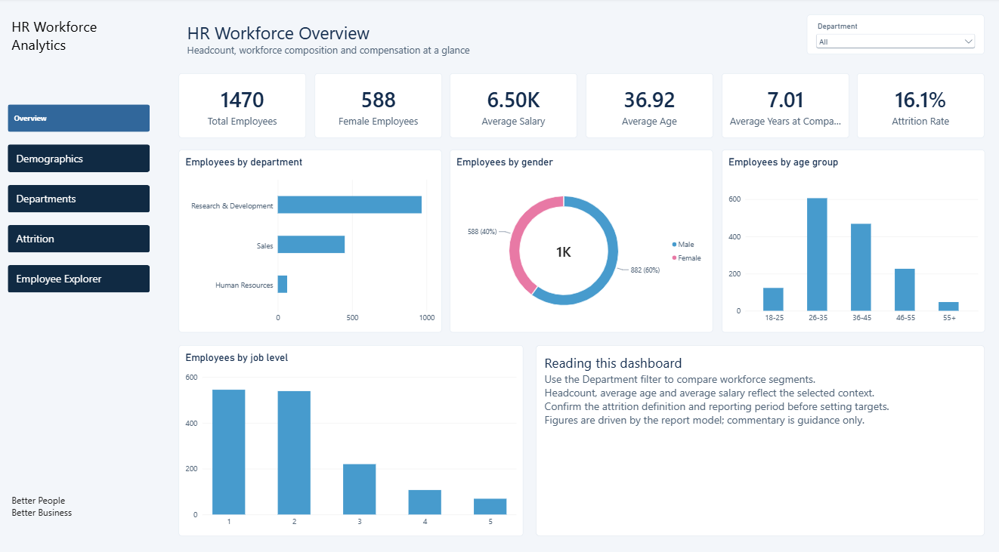
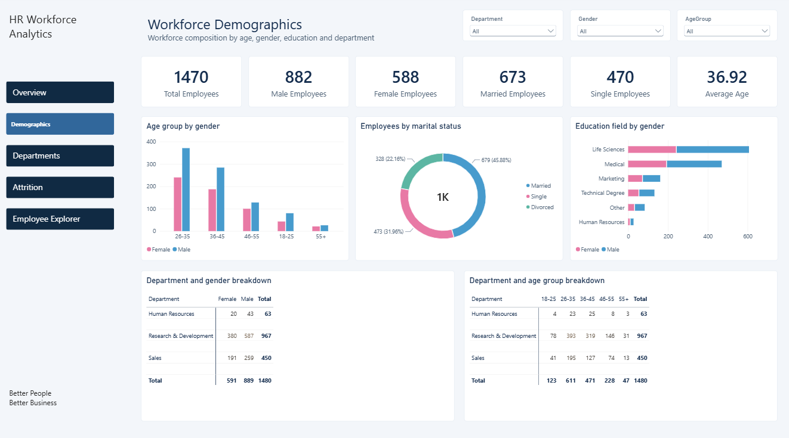
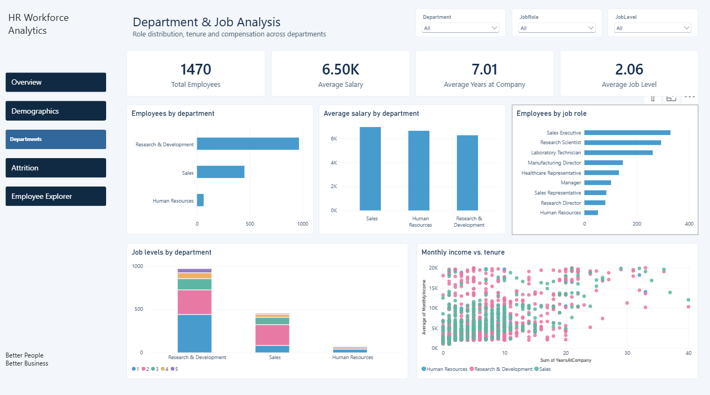
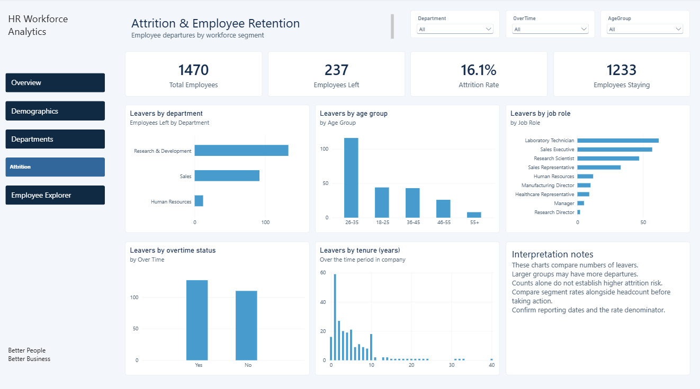
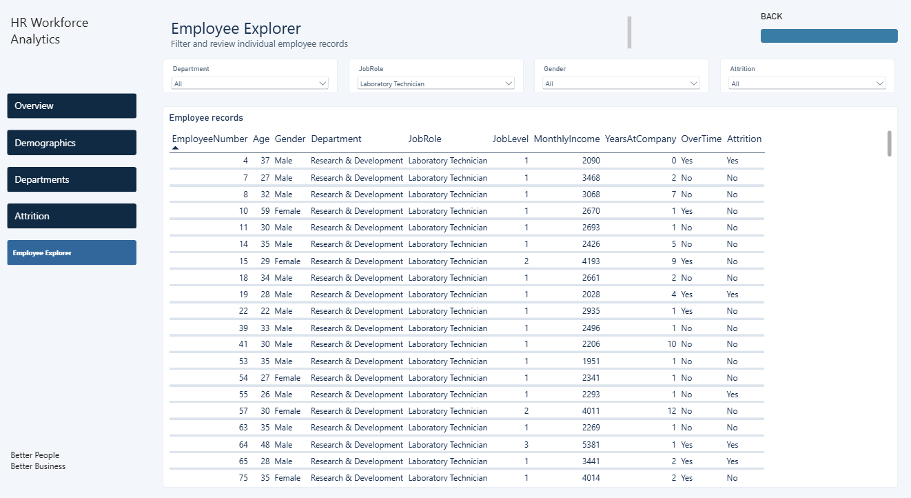

# HR-Analytics-Power-BI-Dashboard
Interactive HR analytics dashboard built with Power BI to explore workforce demographics, compensation, and employee attrition.
The dashboard helps HR stakeholders explore workforce patterns and identify areas that may require further investigation.

**Objectives**
- Analyze employee demographics and workforce composition.
- Compare headcount and average salary across departments and job roles.
- Examine employee attrition across demographic and employment groups.
- Explore the relationship between salary and years at the company.
- Enable interactive filtering for more focused analysis.

**Tools & Technologies Used**
- Microsoft Power BI Desktop
- Power Query, if used for data preparation
- DAX (Data Analysis Expressions)
- GitHub

**Dashboard Pages**
- HR Executive Overview — workforce KPIs and employee distribution.
- Workforce Demographics — age, gender, education, and marital-status analysis.
- Department & Job Analysis — department headcount, job roles, salary, and job level.
- Attrition & Employee Retention — employee exits and attrition patterns.
- Employee Explorer — interactive employee-level filtering and details.

**Key Metrics**
- Total Employees
- Average Age
- Average Monthly Salary
- Employees Left
- Attrition Rate
- Average Years at Company

**Project Files**
- Project.pbix — Power BI report file.
### 1. HR Executive Overview

### 2. Workforce Demographics

### 3. Department & Job Analysis

### 4. Attrition & Employee Retention

### 5. Employee Explorer

**How to Use**
- Download Project.pbix from this repository.
- Open it using Microsoft Power BI Desktop.
- Interact with the report using the slicers and visual filters.

**Data & Privacy**

This dashboard is intended solely for educational and portfolio purposes. The analysis and insights presented are based on the practice dataset and should not be interpreted as findings about any actual organization or its employees.
No confidential company information or real employee records are intentionally included in this project.

**Author**

Aarya Garg
